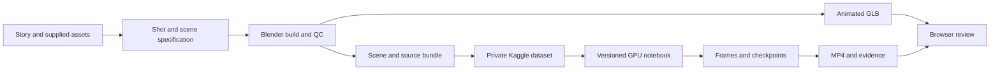

# Architecture and production boundaries

Codex is the production controller: turn a supplied story into versioned scene JSON,
shot timings and reviewed Blender scripts. It is not a separately trained text-to-motion
model. Each stage runs independently so changing animation need not replace source assets.

The example is an original lantern-lit Indian market with a mechanical courier character.
An eight-bone rigid-weight rig, head/antenna overlap, waving and blinking demonstrate
portable animation, rather than pretending primitive humanoids are professional actors.
No external licensed assets, dialogue recordings or human character models were supplied.

## State and storage

Source/configuration live in GitHub. Blend files are packed and bundled with code,
SHA256 manifest and job JSON. Blender files and large image sequences stay outside
source Git; the prepared sample GLB, poster and short MP4 are small enough for the demo.
A private Kaggle dataset transports the bundle, and saved notebook version outputs
transport results. This implementation has no provisioned external object store.
Do not commit secrets, copyrighted third-party assets without rights, or large film outputs.

A job directory binds scene content, settings and renderer source hashes. Progress records
completed frame checksums and elapsed time. Resume decodes and rehashes frames before
skipping them. Interrupted temporary files are rerendered. Partial recovery after a Kaggle
session expires requires actually retained outputs; the system cannot recover deleted RAM
or an unsaved filesystem. A process PID is never evidence of a submitted cloud batch job.

## Quality gates and extensions

Current checks cover imports, mesh data, image availability, armature targets/weights,
active camera, timeline, frame decoding/checksums and encoded frame count. They do not
prove natural human motion, foot contacts, collision-free interaction, camera visibility,
continuity, acting quality or lip sync. Those require supplied assets, contact/retargeting
systems, specialist tools and artistic review.

For longer films, split scripts into scenes and shots; keep stable character/asset IDs,
rig contracts and costume/material versions. Reuse actions through NLA/retargeting,
bake contact-aware IK, produce phoneme timings from licensed voice assets, and review
motion before final renders. None of those advanced systems is represented as implemented.
Use per-shot frame chunks bounded by measured GPU time/memory and Kaggle quotas; combine
validated sequences in editing. The encoder optionally accepts a supplied audio track,
pads short audio and trims it to exact image duration. No voice or music generation
service has been configured. EXR needs a deliberate color-managed conversion before MP4.
